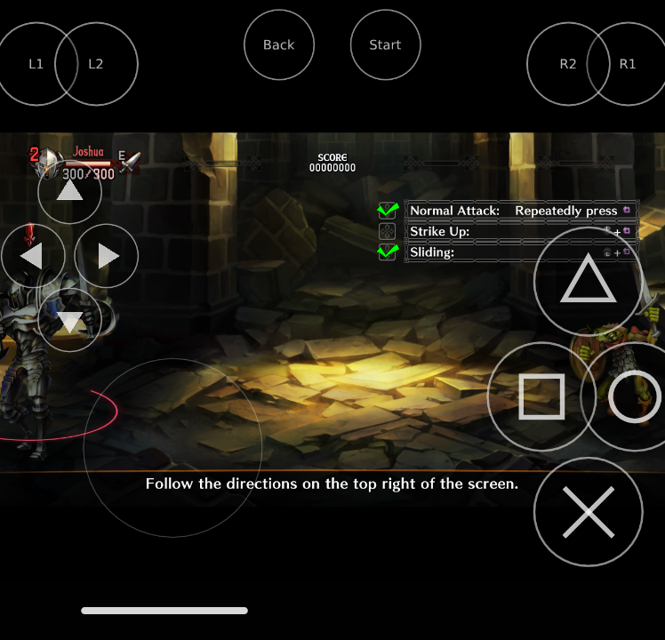
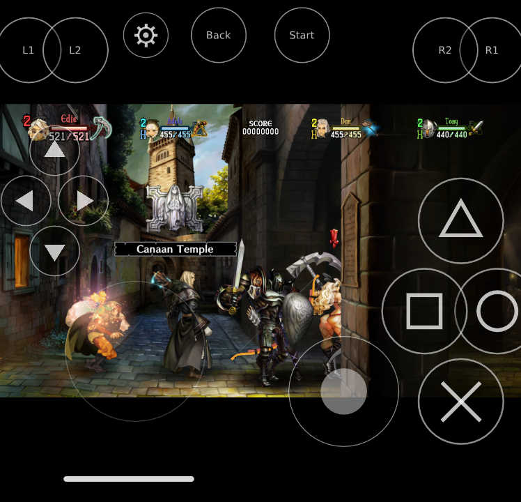
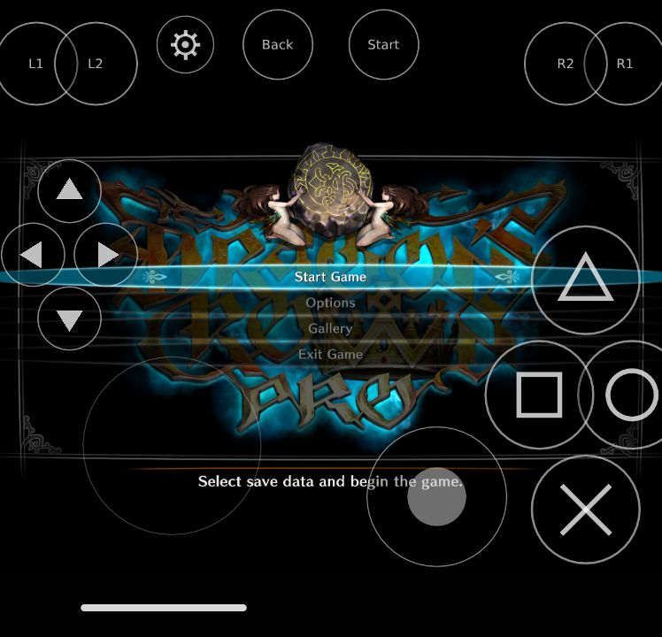
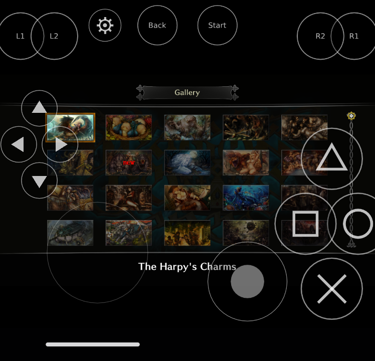
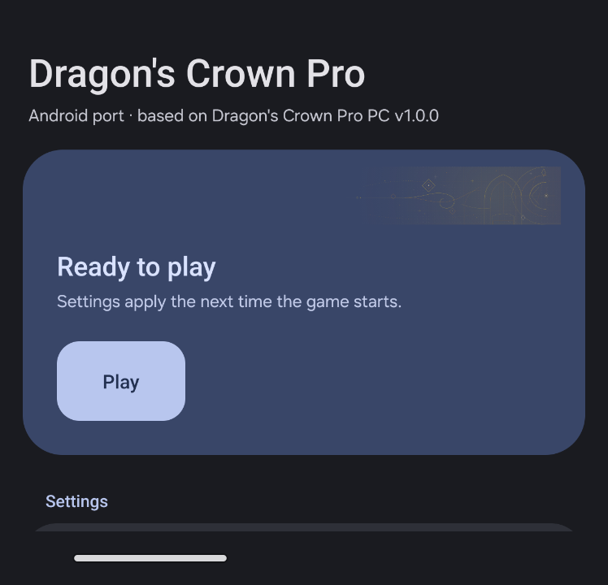
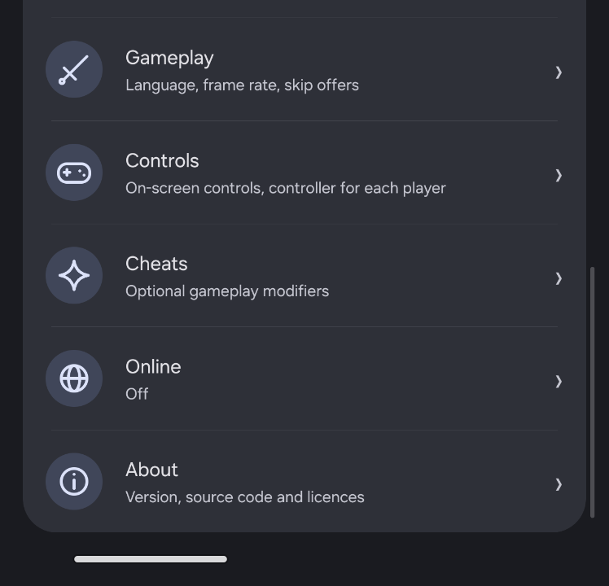
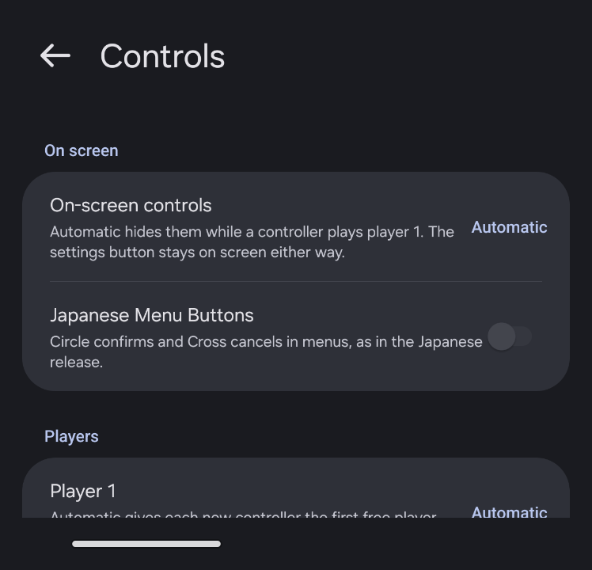
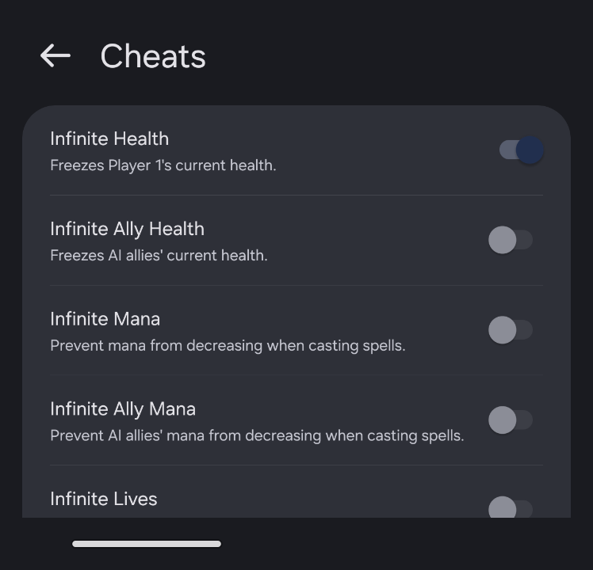
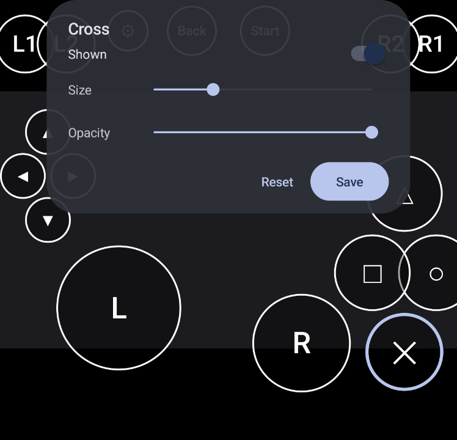

# Dragon's Crown Pro - Android Port

### Vanillaware's PS4 beat 'em up on arm64 Android phones, built on saulob's [Dragon's Crown Pro PC](https://github.com/saulob/dragons-crown-pro-pc) port, with touch controls, a Material You settings app, cheats and online co-op with PC players

-3ddc84?style=for-the-badge&labelColor=07101f)

This is a fork of <a href="https://github.com/saulob/dragons-crown-pro-pc">saulob/dragons-crown-pro-pc</a>. The PC port's loader, runtime and Vulkan renderer are built for Android, and the game's own x86-64 code runs in an embedded <a href="https://github.com/ptitSeb/box64">Box64</a> core. <b>No game files included</b>: bring your own legally obtained Dragon's Crown Pro PS4 package.

  
  

> **Experimental.** Tested on one phone so far, a Galaxy Z Flip5 (Snapdragon 8 Gen 2, Adreno 740, Android 16). For the PC version (Windows, Linux, Steam Deck), use the [upstream repository](https://github.com/saulob/dragons-crown-pro-pc).

## Features

### What the Android build adds

- **Runs on arm64 Android**: the PC port's code, built for Android, with the game's x86-64 code translated by an embedded Box64 core. The port's hooks into the game's code (cheats, Skip Intro, Gallery, Exit Game and the others) are bridged too, so they work as on PC
- **60 fps at 720p** in normal combat on a Snapdragon 8 Gen 2, with the Vulkan renderer on [Mesa Turnip](https://docs.mesa3d.org/drivers/freedreno.html)
- **On-screen touch controls**: a floating left stick, a fixed right stick, the face buttons, the D-pad, the shoulder buttons, Back and Start. Any touch away from the controls goes to the **PS4 touchpad**
- **Layout editor**: move, resize, hide and fade each on-screen control, then save; the game loads your layout
- **Material You settings app**: the launcher redesigned for the phone, in your wallpaper's colours. The **gear** on the game screen opens it while you play, and **Resume** takes you back
- **Controllers**: plug in or pair a gamepad and the touch controls step aside (or turn them off for good). Choose which controller each of players 1 to 4 uses
- **Cheats**: the PC launcher's full list, set from the app. Cheats changed from the in-game gear apply when you resume
- **Online co-op with PC players**: the same online service as the PC port. Phones and PCs play together in the same rooms

### From the PC port, working on Android

- **Graphics**: render resolution (720p is the Android default), aspect ratio, SMAA, texture filtering, FSR 1 upscaling and RCAS sharpening
- **Experimental True Ultrawide** for 21:9 and 32:9 (not yet tried on a phone)
- **Gameplay**: Menu & Subtitles language (including Brazilian Portuguese and the Russian fan translation), frame rate limit, frame counter, Story and Tutorial Skip Offers, **Skip Intro** and **Unlock Gallery**, plus **Japanese NPC Voices** (not yet tried on a phone)
- **Title menu with Exit Game**
- **Japanese Menu Buttons** (Circle confirms)
- **Online**: online name, ping display and the public lobby. Cheats are locked while online play is on, as on PC
- **Saves**: PC saves copy over to the phone as they are

### Not on Android yet

- Importing a game package on the phone: prepare the game with the PC launcher, then copy it over (see [Installing](#installing))
- Sending and accepting friend requests (random rooms and join codes work)
- Trophies, Xbox button prompts and Arachnophobia Safe Mode
- The in-game Cheats menu (F10 on PC); use the settings app's Cheats page
- Discord Rich Presence: Discord's Android app has no local connection for it

## Screenshots

  
  

  
  
  

  
  

## What you need

- An **arm64 Android phone** running Android 13 or newer. An Adreno GPU with Mesa Turnip is the tested setup: Qualcomm's own Vulkan driver hangs the GPU on some of the game's draws
- **A PC with the [PC port](https://github.com/saulob/dragons-crown-pro-pc)**, to install the game once from your package
- **Your own legally obtained Dragon's Crown Pro package**: the supported builds and their checks are listed in the [upstream README](https://github.com/saulob/dragons-crown-pro-pc#what-you-need). The Android build has been played on the USA 1.00 build (`CUSA10454`)
- About 6 GB of free space on the phone

## Installing

1. Install the game on a PC with the PC port's launcher, from your own `.pkg` file.
2. Download the APK from this fork's [releases](https://github.com/Shmubbier/Dragons-crown-android/releases) and install it on the phone.
3. Copy the PC install's prepared game and boot image to the app's files folder (`Android/data/dev.dcpport.android/files`). Copy `game/prepared/v1.03` to `app0/` and `build/image/v1.03` to `image/v1.03/`. Copy your PC `user/` folder too if you want your saves and settings.
4. Set up the Turnip driver (see [docs/ANDROID.md](docs/ANDROID.md#graphics-driver-mesa-turnip)).
5. Open the app and press **Play**.

The release `android-v1.0.0-alpha1` has the game, touch controls and online play. The settings app, the layout editor, the controller choice per player, cheats and the other hook-based options are in the `android-port` branch and will be in the next release.

Folders, `dcp.ini` settings and the driver setup are described in [docs/ANDROID.md](docs/ANDROID.md).

## Building

The Android build runs on Windows (Git Bash) or Linux with the Android SDK, NDK r30 and CMake, without Gradle. `android/CMakeLists.txt` builds `libmain.so` and `android/build-apk.sh` packages the APK. The dependencies (SDL3, Box64 with the patches in `android/patches`, OpenSSL, FreeType and the others) and the exact commands are in [docs/ANDROID.md](docs/ANDROID.md#building).

The PC build is unchanged from upstream; see the [upstream README](https://github.com/saulob/dragons-crown-pro-pc#building-it-yourself).

## Reporting problems

Open an [issue on this fork](https://github.com/Shmubbier/Dragons-crown-android/issues) for Android problems. Attach `logs/console.txt` from the app's files folder, and give your phone model, GPU and driver (Turnip version or the phone's own). Problems that also happen on PC belong [upstream](https://github.com/saulob/dragons-crown-pro-pc/issues).

## Credits

- **[saulob](https://github.com/saulob)** for [Dragon's Crown Pro PC](https://github.com/saulob/dragons-crown-pro-pc), which this fork is built on: the loader, runtime, renderer, launcher, online co-op, cheats and every hook. If you enjoy the port, consider [sponsoring saulob](https://github.com/sponsors/saulob)
- Dragon's Crown Pro by Vanillaware, published by Atlus (2018). This is an unofficial fan-made port. It is not affiliated with or endorsed by Vanillaware, Atlus, SEGA, Sony Interactive Entertainment or any other rights holder, and it contains none of their files
- [Box64](https://github.com/ptitSeb/box64) by ptitSeb and contributors (MIT), which runs the game's x86-64 code on arm64
- [Mesa Turnip](https://docs.mesa3d.org/drivers/freedreno.html) and [libadrenotools](https://github.com/bylaws/libadrenotools) (BSD-2-Clause) for the Adreno Vulkan driver and loading it
- [SDL3](https://github.com/libsdl-org/SDL) (zlib), FreeType, libpng, fmt and OpenSSL 3 (Apache-2.0)
- Everything the PC port credits: [shadPS4](https://github.com/shadps4-emu/shadPS4), [gow3_pc](https://github.com/FelipePrado0/gow3_pc) and its lineage, [OpenCrown-PC](https://github.com/Nezara/OpenCrown-PC), [TRG Launcher](https://github.com/TekRantGaming/trg-launcher), SMAA, AMD FidelityFX Super Resolution 1 and the others in the [upstream credits](https://github.com/saulob/dragons-crown-pro-pc#credits)

## AI disclosure

From the upstream PC port, by saulob: "AI tools were used to assist with code analysis, development, debugging and documentation. Changes were directed, tested and reviewed by the maintainer."

## License

Original code in this project is licensed under the GNU General Public License v2.0 or later (GPL-2.0-or-later). See [LICENSE](LICENSE).

Third-party components retain their respective licenses and notices. See [licenses/THIRD-PARTY-LICENSES.txt](packaging/licenses/THIRD-PARTY-LICENSES.txt). An APK also contains the libraries listed in [docs/ANDROID.md](docs/ANDROID.md#licences).

No game files are included. Dragon's Crown Pro and its assets are not covered by this project's license.
